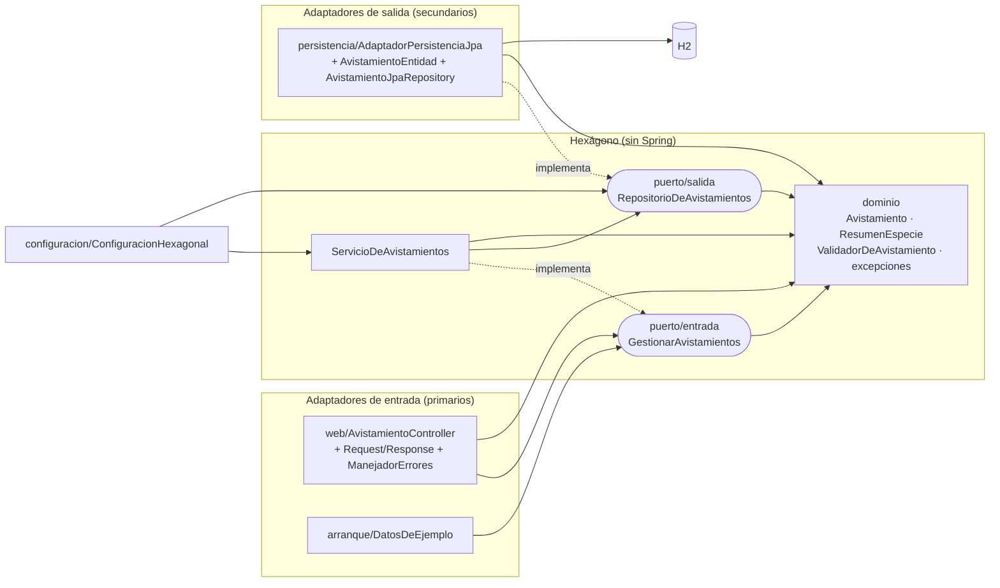
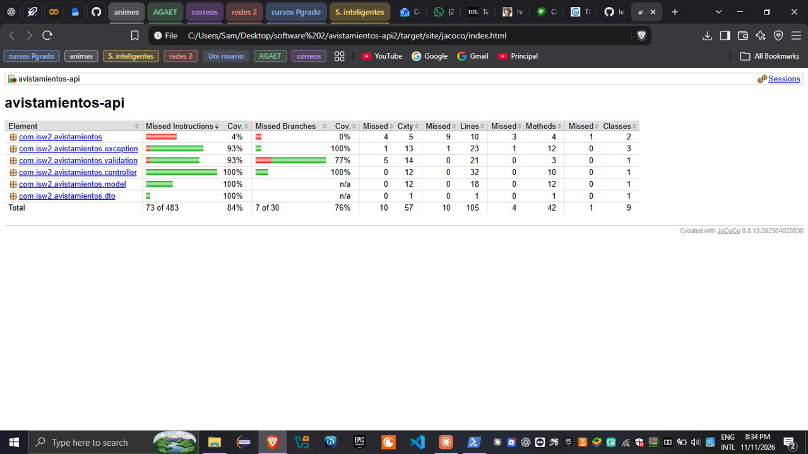
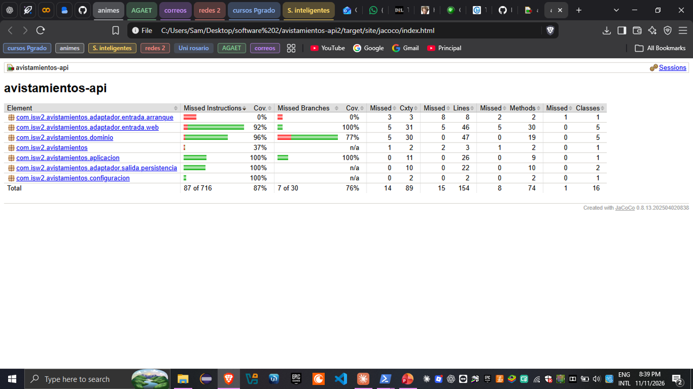

# Taller 5 — Clean Architecture y arquitectura hexagonal

**Ingeniería de Software 2 (ISW-2)** · Miércoles 11 de noviembre de 2026 · Trabajo individual

- **Repositorio:** https://github.com/legendaryjaguar1105/avistamientos-api2
- **Rama:** `refactor-hexagonal` (el estado "antes" es el commit `63fe411` de `main`)

---

## Parte 1. Investigación

### 1. El problema, los puertos y los adaptadores según Cockburn

**El problema.** Cockburn parte de algo que veía repetirse en muchas aplicaciones: la lógica de negocio termina metida dentro del código de la interfaz de usuario (Cockburn, 2005). Eso trae tres consecuencias. La primera es que el sistema no se puede probar con pruebas automáticas, porque parte de la lógica depende de detalles visuales que cambian todo el tiempo. La segunda es que no se puede pasar de un uso manual a uno por lotes (batch). La tercera es que otro programa no puede usar la aplicación directamente (Cockburn, 2005). Cockburn añade que la solución típica, crear una capa nueva "donde esta vez sí no habrá lógica de negocio", fracasa porque nadie tiene cómo detectar cuándo se rompe esa promesa, y a los pocos años la capa está otra vez llena de lógica (Cockburn, 2005). Además, el mismo problema aparece del otro lado: cuando la lógica está amarrada a la base de datos, si la base se cae o se cambia, los desarrolladores no pueden trabajar (Cockburn, 2005).

**Puerto.** Es un punto de comunicación de la aplicación con el exterior, definido por el *propósito* de la conversación y no por la tecnología. Toma la forma de una API. La palabra viene de los puertos de un sistema operativo o de un aparato electrónico: cualquier dispositivo que respete el protocolo del puerto se puede conectar (Cockburn, 2005).

**Adaptador.** Es el código que traduce entre la API del puerto y lo que necesita una tecnología concreta, en ambos sentidos. Un mismo puerto puede tener varios adaptadores. Del lado del usuario: una GUI, un arnés de pruebas automáticas, un script batch o una interfaz HTTP. Del lado de los datos: un adaptador SQL, uno de archivo plano o una base de datos falsa (*mock*) en memoria (Cockburn, 2005).

**La simetría.** Cockburn sostiene que el problema del lado del usuario y el del lado de la base de datos tienen la misma causa: la lógica de negocio está enredada con la interacción con entidades externas (Cockburn, 2005). Por eso la diferencia que importa no es entre "arriba y abajo" o "izquierda y derecha", como sugieren los diagramas de capas, sino entre *adentro* (la aplicación) y *afuera* (todo lo demás). Vista así, la base de datos es un actor externo más, igual que el usuario, y ambos lados se resuelven con el mismo mecanismo: puertos y adaptadores intercambiables (Cockburn, 2005). El hexágono no tiene seis lados por alguna razón especial; la forma solo sirve para alejarse del dibujo de capas apiladas y dejar espacio para dibujar varios puertos (Cockburn, 2005). Más adelante Cockburn matiza que, en la implementación, sí se distinguen los puertos *primarios* (los que inician la conversación y manejan la aplicación, como el usuario) de los *secundarios* (los que la aplicación maneja, como la base de datos), pero aclara que esa distinción es una consecuencia del patrón y no su idea central (Cockburn, 2005).

### 2. Los círculos de Clean Architecture y la regla de dependencia

Martin (2012) dibuja cuatro círculos concéntricos. De adentro hacia afuera:

| Círculo | Qué va ahí |
|---|---|
| **Entities** (entidades) | Las reglas de negocio más generales, válidas para toda la organización. Son los objetos de negocio, lo que menos cambia cuando cambia algo externo (Martin, 2012). |
| **Use Cases** (casos de uso) | Las reglas de negocio propias de *esta* aplicación. Orquestan el flujo de datos hacia y desde las entidades para cumplir el objetivo de cada caso de uso. No deben verse afectados por cambios en la base de datos, la UI o los frameworks (Martin, 2012). |
| **Interface Adapters** (adaptadores de interfaz) | Convierten los datos entre el formato que les conviene a los casos de uso y el formato que les conviene a los agentes externos. Aquí van los controladores, los presentadores y las vistas, y también todo el SQL (Martin, 2012). |
| **Frameworks and Drivers** | La capa más externa: la base de datos, el framework web y demás herramientas. Casi solo tiene código de "pegamento". Martin la describe como el lugar de los detalles: la web y la base de datos son detalles (Martin, 2012). |

Martin aclara que los cuatro círculos son un esquema: puede haber más, siempre que se cumpla la regla de dependencia (Martin, 2012).

**La regla de dependencia.** Las dependencias de *código fuente* solo pueden apuntar hacia adentro, hacia las políticas de más alto nivel (Martin, 2012). Lo que prohíbe es que un círculo interno sepa cualquier cosa de uno externo: el código de adentro no puede mencionar el nombre de nada declarado afuera, sean funciones, clases o variables (Martin, 2012). La prohibición se extiende a los formatos de datos: un círculo interno tampoco debe usar estructuras definidas por una capa externa, en particular las que genera un framework (Martin, 2012). Por eso, lo que cruza las fronteras deben ser estructuras de datos simples (DTOs, argumentos de funciones), en el formato que le conviene al círculo interno, y no entidades ni filas de la base de datos (Martin, 2012).

### 3. Cómo guarda datos un caso de uso sin depender de la base de datos

**La contradicción.** En tiempo de ejecución, el flujo de control va del caso de uso hacia afuera: el caso de uso llama a quien guarda los datos. Pero la regla de dependencia exige que el código fuente apunte hacia adentro. Si el caso de uso llamara directamente a la clase que habla con la base de datos, estaría mencionando un nombre de un círculo externo (Martin, 2012).

**El mecanismo.** Martin lo resuelve con el principio de inversión de dependencias (la "D" de SOLID): el círculo interno *define una interfaz* con lo que necesita, y una clase del círculo externo *la implementa* (Martin, 2012). En el artículo lo ilustra con la salida hacia el presentador: el caso de uso llama a una interfaz que vive adentro (el *Use Case Output Port*) y el presentador, que está afuera, la implementa. Con polimorfismo dinámico se logra que la dependencia de código fuente vaya en sentido contrario al flujo de control, y la misma técnica sirve para cruzar cualquier frontera (Martin, 2012). Palermo describe lo mismo para la persistencia: la interfaz del repositorio vive en el núcleo, la clase que la implementa con una tecnología de acceso a datos concreta vive en el borde, y se inyecta en tiempo de ejecución (Palermo, 2008). El ejemplo de Cockburn sigue el mismo patrón: la aplicación de descuentos recibe por constructor una interfaz `RateRepository`, y se le puede pasar un mock en memoria o la base de datos real (Cockburn, 2005).

**Ejemplo con la API de avistamientos** (pseudocódigo):

```text
// Círculo de casos de uso: el caso de uso DEFINE lo que necesita
interface RepositorioAvistamientos {
    guardar(avistamiento: Avistamiento): Avistamiento
}

class RegistrarAvistamiento {
    constructor(repo: RepositorioAvistamientos)   // depende de la interfaz
    ejecutar(datos) {
        avistamiento = new Avistamiento(datos)    // la entidad valida sus reglas
        return repo.guardar(avistamiento)
    }
}

// Círculo de adaptadores: la clase concreta IMPLEMENTA la interfaz
class RepositorioAvistamientosSQL implements RepositorioAvistamientos {
    guardar(avistamiento) { /* INSERT ... */ }
}

// Capa externa (arranque de la app): se conectan las piezas
caso = new RegistrarAvistamiento(new RepositorioAvistamientosSQL(conexion))
```

El flujo de control va `RegistrarAvistamiento → RepositorioAvistamientosSQL`, pero la flecha de dependencia del código va `RepositorioAvistamientosSQL → RepositorioAvistamientos`, es decir, hacia adentro. En las pruebas se puede pasar un `RepositorioAvistamientosEnMemoria` sin tocar el caso de uso.

### 4. Comparación: hexagonal, cebolla y Clean Architecture

**Lo que tienen en común.** Martin afirma que, aunque difieren en detalles, estas arquitecturas son muy parecidas: todas buscan la separación de responsabilidades, separan al menos una capa de reglas de negocio de otra de interfaces, y producen sistemas que se pueden probar sin UI ni base de datos y que no dependen de frameworks ni de la base de datos (Martin, 2012). Palermo reconoce que su propuesta comparte con la hexagonal la misma premisa: sacar la infraestructura hacia afuera y escribir adaptadores para que no quede acoplada (Palermo, 2008). En las tres, la base de datos deja de ser el centro: Palermo lo dice explícitamente (Palermo, 2008), Cockburn la trata como un actor externo más (Cockburn, 2005) y Martin la llama un detalle (Martin, 2012). Las tres se apoyan en el principio de inversión de dependencias para que el núcleo defina interfaces y el exterior las implemente (Cockburn, 2005; Palermo, 2008; Martin, 2012).

**Lo que cambia.**

| | Hexagonal (Cockburn, 2005) | Cebolla (Palermo, 2008) | Clean (Martin, 2012) |
|---|---|---|---|
| **Vocabulario** | Puertos, adaptadores, primarios/secundarios (*driving/driven*) | Domain Model, servicios, interfaces de repositorio, infraestructura | Entities, Use Cases, Interface Adapters, Frameworks & Drivers |
| **Capas** | No organiza el interior en capas: solo hay un *adentro* (la aplicación) y un *afuera* | Varias capas concéntricas dentro del núcleo, en número variable, con el modelo de dominio en el centro | Cuatro círculos con nombre, aunque Martin dice que pueden ser más |
| **Figura** | Hexágono, para escapar del dibujo de capas y dejar espacio a varios puertos | Círculos concéntricos | Círculos concéntricos |
| **Énfasis** | Que la aplicación pueda ser manejada igual por personas, programas o pruebas, y probarse aislada | Controlar el acoplamiento en aplicaciones empresariales de larga vida; abiertamente orientada a objetos | Una sola regla (la de dependencia) y cómo cruzar fronteras con datos simples |

En resumen, no cambia la idea central sino tres cosas. La primera es el vocabulario. La segunda es cuánto estructuran el interior: Cockburn lo deja como una caja, mientras que Palermo y Martin lo dividen en capas (Cockburn, 2005; Palermo, 2008; Martin, 2012). La tercera es el motivo que destacan: Cockburn insiste en las pruebas y en los múltiples actores, Palermo en el costo de mantener sistemas cuyo acceso a datos cambia con frecuencia, y Martin presenta su diagrama como un intento de integrar las anteriores en una sola idea (Cockburn, 2005; Palermo, 2008; Martin, 2012).

### 5. ¿Se justifica Clean Architecture en esta API?

**Posición: no, para esta API tal como está.** Aplicarla completa cuesta más de lo que aporta.

**Costo (trade-off).** Cada endpoint pasa de un archivo (el controlador) a varios: entidad, caso de uso, interfaz del repositorio, implementación del repositorio, controlador adaptador y el código que conecta todo. Además, los datos se convierten en cada frontera, porque Martin pide que crucen como estructuras simples y no como entidades ni filas de la base (Martin, 2012). En una API de pocos endpoints, esa indirección hace más difícil seguir el código. El propio Palermo advierte que su arquitectura no es apropiada para sitios web pequeños y que está pensada para aplicaciones de larga vida o con comportamiento complejo (Palermo, 2008).

**Beneficio.** La regla de validación queda en el núcleo, sin depender del framework, y se puede probar con pruebas unitarias sin levantar el servidor ni la base de datos (Martin, 2012). Ese es justamente el problema que Cockburn quería resolver (Cockburn, 2005). También se podría cambiar la base de datos sin tocar la regla (Martin, 2012).

**Por qué gana el costo.** El beneficio crece con la cantidad de reglas de negocio y con el tiempo que va a vivir el sistema. Con una sola regla de validación, ya se obtiene casi todo ese beneficio extrayéndola a una función pura, sin depender del framework, y probándola aparte, sin crear todas las capas. Si la API creciera (más reglas, otra base de datos, otro cliente además de HTTP), cambiaría mi posición, porque ahí el acoplamiento sí empezaría a costar.

**El refactor lo confirma.** El código de `src/main/java` pasó de 10 archivos y 417 líneas a 19 archivos y 699 líneas (+68 %), y la API hace exactamente lo mismo que antes. El costo es real: para registrar un avistamiento, una petición ahora pasa por el controlador, el DTO de entrada, el puerto de entrada, el servicio, el puerto de salida, el adaptador JPA y la entidad, con tres conversiones de datos en el camino. A cambio, el núcleo (`dominio` y `aplicacion`) compila sin Spring y el servicio se puede probar con un repositorio en memoria. Pero ese beneficio ya existía en parte, porque `ValidadorDeAvistamiento` estaba aislado y probado desde el taller anterior.

---

## Parte 2. Aplicación

### Arquitectura elegida: hexagonal (puertos y adaptadores)

Elegí la arquitectura hexagonal (Cockburn, 2005) porque se ajusta al tamaño de la API. Solo hay un *adentro*, que es la aplicación con sus reglas, y un *afuera* con dos tipos de actores: los que manejan la aplicación (HTTP y la carga de datos de ejemplo) y lo que la aplicación maneja (la base de datos H2). No hace falta repartir el interior en cuatro círculos como en Clean Architecture.

El vocabulario del código es el de Cockburn:

- **Puerto de entrada (primario).** `GestionarAvistamientos` es la conversación "gestionar avistamientos" que la aplicación ofrece.
- **Puerto de salida (secundario).** `RepositorioDeAvistamientos` es la conversación "guardar y consultar avistamientos" que la aplicación necesita.
- **Adaptadores de entrada.** El controlador REST y `DatosDeEjemplo` son dos adaptadores distintos para el mismo puerto, que es justo lo que Cockburn describe con varias tecnologías conectadas a un puerto (Cockburn, 2005).
- **Adaptador de salida.** `AdaptadorPersistenciaJpa` implementa el puerto de salida con Spring Data JPA y H2.

Dentro del hexágono separé `dominio/` (el modelo y la regla de validación) de `aplicacion/` (los puertos y el servicio). Esa separación solo ordena paquetes: los dos están adentro y ninguno depende de Spring.

### Estructura de carpetas

```
src/main/java/com/isw2/avistamientos/
├── AvistamientosApplication.java
├── dominio/                                  ← DENTRO del hexágono (Java puro)
│   ├── Avistamiento.java
│   ├── ResumenEspecie.java
│   ├── ValidadorDeAvistamiento.java
│   ├── AvistamientoInvalidoException.java
│   └── AvistamientoNoEncontradoException.java
├── aplicacion/                               ← DENTRO del hexágono (Java puro)
│   ├── puerto/entrada/GestionarAvistamientos.java
│   ├── puerto/salida/RepositorioDeAvistamientos.java
│   └── ServicioDeAvistamientos.java
├── adaptador/                                ← FUERA del hexágono
│   ├── entrada/web/
│   │   ├── AvistamientoController.java
│   │   ├── AvistamientoRequest.java          (JSON de entrada + Bean Validation)
│   │   ├── AvistamientoResponse.java         (JSON de salida)
│   │   ├── ResumenEspecieResponse.java
│   │   └── ManejadorErrores.java             (excepciones → 400/404/415)
│   ├── entrada/arranque/
│   │   └── DatosDeEjemplo.java
│   └── salida/persistencia/
│       ├── AdaptadorPersistenciaJpa.java
│       ├── AvistamientoEntidad.java          (@Entity, misma tabla)
│       └── AvistamientoJpaRepository.java    (Spring Data)
└── configuracion/
    └── ConfiguracionHexagonal.java           (conecta servicio + adaptador)

src/test/java/com/isw2/avistamientos/
├── AvistamientoControllerTest.java           (integración, MockMvc)
└── dominio/ValidadorDeAvistamientoTest.java  (unitarias)
```

### Diagrama de dependencias

Las flechas son dependencias de **código fuente** (`A → B` significa "A importa a B"). Todas apuntan hacia el núcleo. Las flechas punteadas indican "implementa", y aunque el flujo de control va del servicio hacia la base de datos, el código del adaptador es el que depende del puerto (inversión de dependencias).



Versión en texto, por si el visor no muestra Mermaid:

```
 [web] ──────────┐                                   ┌───────── [persistencia JPA] ──→ (H2)
 [arranque] ──→ (GestionarAvistamientos) ◁·· Servicio ──→ (RepositorioDeAvistamientos) ◁··┘
                         │                    │                    │
                         └──────────→ [ dominio ] ←────────────────┘
 [configuracion] ──→ Servicio, puerto de salida          ──→ depende de    ◁·· implementa
```

**Cómo se comprueba la regla de dependencia.** `dominio/` y `aplicacion/` compilan solos con `javac`, sin ninguna librería en el classpath (8 clases). Si el núcleo importara algo de Spring, JPA o Jackson, no compilaría. Se puede repetir así:

```powershell
javac -d $env:TEMP\nucleo (Get-ChildItem -Recurse src\main\java\com\isw2\avistamientos\dominio, src\main\java\com\isw2\avistamientos\aplicacion -Filter *.java).FullName
```

Además, los únicos `import` de esas carpetas son de `java.*` y del propio núcleo.

### Historial de commits

| Commit | Qué hace |
|---|---|
| `63fe411` Subir proyecto inicial | Estado "antes" (entrega del taller de pruebas) |
| `4eaa88c` Mover reglas de negocio al paquete dominio | Validador y excepciones pasan a `dominio/`. |
| `ba5daa0` Agregar puertos, servicio de aplicación y adaptador JPA | El controlador deja de usar el repositorio y habla con el puerto de entrada. |
| `56b1f8a` Separar el modelo de dominio de JPA y de JSON | `Avistamiento` queda en Java puro, con una entidad JPA y DTOs web aparte. |
| `1d9f05a` Ubicar adaptadores de entrada según la arquitectura hexagonal | Controlador, errores y datos de ejemplo pasan a `adaptador/entrada/`. |
| `c3859c6` Documentar la arquitectura hexagonal | README e informe. |
| `Agregar evidencia antes y después` | Salidas de pruebas, cobertura y API en `docs/evidencia/`. |

### Cambios en las pruebas

Las aserciones no cambiaron. Solo cambiaron 3 líneas, todas por el movimiento de paquetes:

- `ValidadorDeAvistamientoTest` pasó de `validation/` a `dominio/` y perdió el import de `model.Avistamiento`, porque ahora está en el mismo paquete.
- `AvistamientoControllerTest` usa el repositorio de Spring Data para vaciar la base antes de cada prueba. Ese repositorio ahora vive en el adaptador, así que cambió el import y el tipo del campo (`AvistamientoRepository` → `AvistamientoJpaRepository`).

### Evidencia antes y después del refactor

Todo se corrió en Windows, el 11 de noviembre de 2026, con estos comandos desde la carpeta del proyecto:

```powershell
git checkout 63fe411                 # ANTES   (después: git checkout refactor-hexagonal)
.\mvnw.cmd clean verify              # pruebas + reporte JaCoCo
.\mvnw.cmd spring-boot:run           # y en otra terminal, los tres curl de abajo
```

Los archivos completos quedaron en [`docs/evidencia/`](evidencia/):

- Salida de Maven: `antes-pruebas.txt` y `despues-pruebas.txt`.
- Respuestas de la API: `antes-api.txt` y `despues-api.txt`.
- Reportes JaCoCo navegables: `cobertura-antes/` y `cobertura-despues/`.
- Capturas de la cobertura.

#### Pruebas

| | Antes (`63fe411`) | Después (`refactor-hexagonal`) |
|---|---|---|
| `AvistamientoControllerTest` (integración) | 18 pruebas, 0 fallas | 18 pruebas, 0 fallas |
| `ValidadorDeAvistamientoTest` (unitarias) | 11 pruebas, 0 fallas (paquete `validation`) | 11 pruebas, 0 fallas (paquete `dominio`) |
| **Total** | **29, Failures: 0, Errors: 0** | **29, Failures: 0, Errors: 0** |
| Resultado | `BUILD SUCCESS` (28,8 s) | `BUILD SUCCESS` (26,1 s) |

Salida de Maven, antes:

```
[INFO] Tests run: 18, Failures: 0, Errors: 0, Skipped: 0, Time elapsed: 15.43 s -- in com.isw2.avistamientos.AvistamientoControllerTest
[INFO] Running com.isw2.avistamientos.validation.ValidadorDeAvistamientoTest
[INFO] Tests run: 11, Failures: 0, Errors: 0, Skipped: 0, Time elapsed: 0.053 s -- in com.isw2.avistamientos.validation.ValidadorDeAvistamientoTest
[INFO] Results:
[INFO] Tests run: 29, Failures: 0, Errors: 0, Skipped: 0
[INFO] --- jacoco:0.8.13:report (reporte-cobertura) @ avistamientos-api ---
[INFO] Analyzed bundle 'avistamientos-api' with 9 classes
[INFO] BUILD SUCCESS
[INFO] Total time:  28.803 s
```

Salida de Maven, después:

```
[INFO] Tests run: 18, Failures: 0, Errors: 0, Skipped: 0, Time elapsed: 14.10 s -- in com.isw2.avistamientos.AvistamientoControllerTest
[INFO] Running com.isw2.avistamientos.dominio.ValidadorDeAvistamientoTest
[INFO] Tests run: 11, Failures: 0, Errors: 0, Skipped: 0, Time elapsed: 0.038 s -- in com.isw2.avistamientos.dominio.ValidadorDeAvistamientoTest
[INFO] Results:
[INFO] Tests run: 29, Failures: 0, Errors: 0, Skipped: 0
[INFO] --- jacoco:0.8.13:report (reporte-cobertura) @ avistamientos-api ---
[INFO] Analyzed bundle 'avistamientos-api' with 16 classes
[INFO] BUILD SUCCESS
[INFO] Total time:  26.075 s
```

#### Cobertura (JaCoCo)

| Métrica (fila Total) | Antes | Después |
|---|---|---|
| Instrucciones | 84 % (73 sin cubrir de 483) | 87 % (87 sin cubrir de 716) |
| Ramas | 76 % (7 sin cubrir de 30) | 76 % (7 sin cubrir de 30) |
| Líneas | 95 de 105 cubiertas (90 %) | 139 de 154 cubiertas (90 %) |
| Métodos | 38 de 42 cubiertos | 66 de 74 cubiertos |
| Clases | 8 de 9 cubiertas | 15 de 16 cubiertas |

Cobertura por paquete, después del refactor:

| Paquete | Instrucciones | Ramas |
|---|---|---|
| `aplicacion` | 100 % | 100 % |
| `adaptador.salida.persistencia` | 100 % | n/a |
| `configuracion` | 100 % | n/a |
| `dominio` | 96 % | 77 % |
| `adaptador.entrada.web` | 92 % | 100 % |
| `com.isw2.avistamientos` (main) | 37 % | n/a |
| `adaptador.entrada.arranque` | 0 % | 0 % |

Antes:



Después:



#### Muestra de que la API responde igual

Se levantó la API en los dos momentos, sobre la misma base H2 con los datos de ejemplo, y se hicieron las mismas tres peticiones. Abajo están las respuestas *después* del refactor; las de *antes* son idénticas salvo la línea `Date:` (ver `fc` más abajo).

`curl.exe -i http://localhost:8080/avistamientos/1`

```
HTTP/1.1 200
Content-Type: application/json

{
  "id" : 1,
  "especie" : "colibrí",
  "lugar" : "Jardín Botánico de Bogotá",
  "fecha" : "2026-09-12",
  "observador" : "Ana Pérez"
}
```

`curl.exe -i -X POST http://localhost:8080/avistamientos -H "Content-Type: application/json" -d "@ejemplos/incompleto.json"`

```
HTTP/1.1 400
Content-Type: application/json

{
  "status" : 400,
  "error" : "Datos inválidos",
  "mensaje" : "Revisa los campos marcados",
  "campos" : {
    "observador" : "El observador es obligatorio",
    "lugar" : "El lugar es obligatorio",
    "fecha" : "La fecha es obligatoria"
  }
}
```

`curl.exe -i http://localhost:8080/avistamientos/999`

```
HTTP/1.1 404
Content-Type: application/json

{
  "status" : 404,
  "error" : "No encontrado",
  "mensaje" : "No existe un avistamiento con id 999"
}
```

Nota: en la consola de Windows las tildes salen como `colibr├¡`. Es solo cómo la consola muestra el UTF-8; el JSON es el mismo en los dos momentos.

Comparación automática de los dos archivos con `fc.exe docs\evidencia\antes-api.txt docs\evidencia\despues-api.txt`: las únicas diferencias que reporta son los dígitos de la hora en las tres líneas `Date:` (`01:36:13` contra `01:41:10`, y `01:36:18` contra `01:41:12`). Los códigos de estado, los headers y los cuerpos JSON son iguales.

#### Comparación

- **Funcionamiento.** Pasan las mismas 29 pruebas antes y después, sin cambiar ninguna aserción. Las tres respuestas de la API son iguales byte a byte, salvo la fecha del header.
- **Ramas: 76 % en los dos momentos (las mismas 7 de 30 sin cubrir).** Era lo esperable, porque el refactor movió las decisiones del código (las reglas del validador, el 404 y el orden validar-y-luego-buscar) pero no agregó ni quitó ninguna. Es otra señal de que la lógica es la misma.
- **Instrucciones: de 84 % a 87 %.** Sube porque el código nuevo (puertos, servicio, DTOs y conversiones entre capas) queda ejecutado completo por las pruebas de integración. No es que haya más pruebas. El código creció de 483 a 716 instrucciones, el costo de indirección del que habla la pregunta 5.
- **Lo que sigue sin cubrir** es lo mismo de antes: `DatosDeEjemplo`, que las pruebas apagan con `app.datos-ejemplo=false`, y el `main`. Ahora `aplicacion` y `adaptador.salida.persistencia` quedan al 100 %.

### Lo más difícil de separar y por qué

**1. Las validaciones de entrada vivían dentro de la entidad JPA.** Antes, la clase `Avistamiento` hacía tres trabajos a la vez. Era la fila de la base de datos (`@Entity`, `@Column`), era el formato JSON (`@JsonProperty(READ_ONLY)` para ignorar el `id` del cliente) y además validaba la entrada (`@NotBlank`, `@Size`, `@Pattern`). Al sacar el modelo de dominio, esas anotaciones no podían quedarse en él sin romper la regla de dependencia. Pero tampoco podía borrarlas, porque los mensajes de error 400 (por ejemplo, "El lugar es obligatorio" y "Revisa los campos marcados") salen justamente de ellas, y la API tenía que responder igual. La solución fue repartir esa clase en tres: `AvistamientoRequest` en el adaptador web (JSON de entrada más validación de formato), `AvistamientoEntidad` en el adaptador de persistencia (la fila, con la misma tabla y columnas para no perder los datos de H2) y `Avistamiento` en el dominio, sin anotaciones. Lo delicado fue conservar el orden de las validaciones. Primero responde Bean Validation y después la regla de negocio del dominio (fecha no futura), y en el `PUT` la validación va antes de buscar el id, así que unos datos inválidos dan 400 aunque el id no exista.

**2. Decidir qué es negocio y qué es HTTP en los errores.** `AvistamientoNoEncontradoException` y `AvistamientoInvalidoException` son del dominio, pero el manejador que las convierte en 404 y 400 es de Spring MVC. Dejé las excepciones adentro, sin ningún código HTTP, y moví `ManejadorErrores` al adaptador web. El dominio dice "no existe"; el adaptador decide que eso es un 404.

**3. Conectar las piezas sin anotar el núcleo con Spring.** Lo cómodo habría sido poner `@Service` en `ServicioDeAvistamientos`, pero eso hace que el núcleo dependa del framework. En su lugar, `ConfiguracionHexagonal` (afuera) crea el servicio y le pasa el adaptador de salida por el constructor. Es lo mismo que hace Cockburn en su ejemplo, cuando el adaptador de entrada le entrega a la aplicación el repositorio que debe usar (Cockburn, 2005).

**4. La prueba de integración conoce la base de datos.** `AvistamientoControllerTest` limpia la base con el repositorio de Spring Data. Es razonable, porque esa prueba ejercita el sistema completo, adaptadores incluidos. Pero obligó a cambiarle un import, y muestra que las pruebas de integración quedan del lado de *afuera* del hexágono.

### Uso de IA

Usé Claude (Anthropic) como apoyo para leer las fuentes, organizar las respuestas y hacer el refactor. Las pruebas, la cobertura y las respuestas de la API las corrí yo en mi computador; los resultados son los de esta sección.

---

## Referencias

Cockburn, A. (2005). *Hexagonal architecture: The pattern: Ports and Adapters* (HaT Technical Report 2005.02). https://alistair.cockburn.us/hexagonal-architecture/

Martin, R. C. (2012, 13 de agosto). *The Clean Architecture*. The Clean Code Blog. https://blog.cleancoder.com/uncle-bob/2012/08/13/the-clean-architecture.html

Palermo, J. (2008, 29 de julio). *The Onion Architecture: part 1*. Programming with Palermo. https://jeffreypalermo.com/2008/07/the-onion-architecture-part-1/
